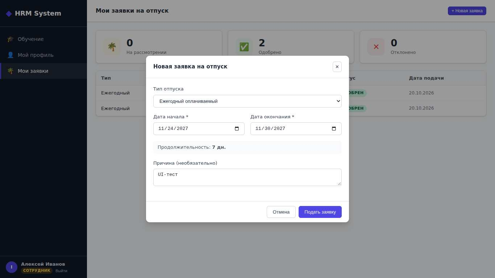

# BUG-003: «Мои заявки»: сотрудник не может подать заявку на отпуск — форма не передаёт employee, API отвечает 400, пользователю ничего не показывается

| Поле | Значение |
| --- | --- |
| Severity | Critical |
| Priority | High |
| Модуль | Отпуска |
| Связанный кейс | TC-LV-03 |
| Статус | New |

**Предусловия:** Вход под ivanov (EMPLOYEE)

**Шаги воспроизведения:**
1. Открыть «Мои заявки»
2. «+ Новая заявка»
3. Указать даты
4. «Подать заявку»

**Ожидаемый результат:** Заявка создана и появилась в списке со статусом «На рассмотрении»

**Фактический результат:** Окно остаётся открытым, заявка не создаётся, сообщения нет. В запросе POST /api/leaves/ отсутствует поле employee → HTTP 400 (MyLeavesView.vue: createLeave без employee, нет catch)

**Доказательство:** Запрос POST /api/leaves/ из этой формы уходит без поля `employee` и получает HTTP 400 — пользователю ничего не показывается.

